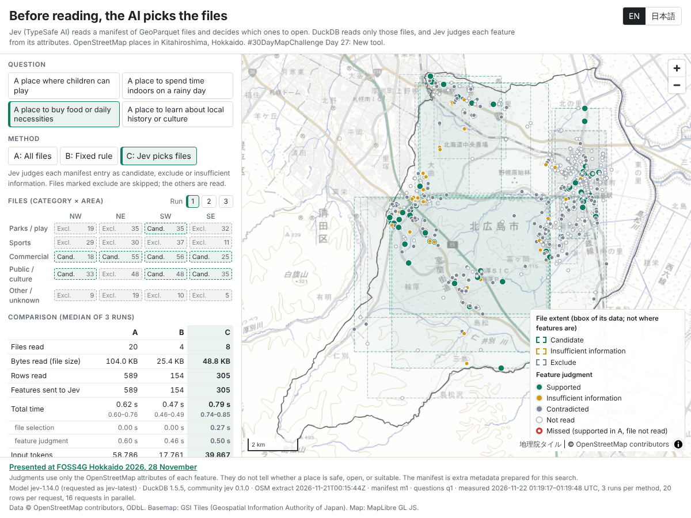

# Before reading, the AI picks the files

**読む前に、AIがファイルを選ぶ** — #30DayMapChallenge 2026 Day 27「New tool」



## Cloudflare のビルド設定

| 項目 | 値 |
|---|---|
| Root directory（ルートディレクトリ） | `web` |
| Build command（ビルドコマンド） | `npm ci && npm run build` |
| Build output directory（出力先） | `dist` |
| Node のバージョン | 22（`web/.node-version` で指定。環境変数 `NODE_VERSION=22` でも可） |

- 配信物は静的ファイルだけです（HTML・JS・CSS・JSON）。Jev の結果は計算済みの JSON（`web/public/data/`）として同梱しており、配信物に API キーは入りません。
- 最も大きいファイルは JS バンドルの約 1.1 MB、全体で約 2 MB です。Cloudflare の静的ファイルの上限（1ファイル 25 MiB）に収まります。

## 作品について

北海道北広島市の OpenStreetMap の地物 589 件を、属性のカテゴリ（5種）と地区（4区分）で 20 個の GeoParquet ファイルに分けました。ファイルごとの要約を目録（`data/manifest.json`）にまとめています。

自然言語の質問を受けると、Jev（TypeSafe AI）が目録の各項目を評価して、読むファイルを決めます。DuckDB はそのファイルだけを読み、地物ごとの判定も Jev が行います。読むファイルの決め方を 3 通り（A・B・C）用意して、時間・API 使用量・候補の取りこぼしを比べました。

画面では、質問と方式を選ぶと次のように表示されます。

- 各ファイルの受け持ち範囲（bbox）を、破線の枠で示します。色はファイル選択の結果です。
  - 方式C: 候補／除外／判断材料不足
  - 方式A・B: 読む／読まない
- bbox は、そのファイルに入っているデータの範囲です。地物がある位置そのものではありません。
- 地物の判定（supported／contradicted／insufficient_information）を点の色で示します。点をクリックすると、名前と、Jev に送った属性を表示します。
- 方式Aで supported になったのに、その方式が読まなかったファイルに入っていた地物は、取りこぼしとして赤い輪で示します。
- 3 回の計測から 1 回を選んで表示できます。
- 英語と日本語を切り替えられます。URL でも指定できます（例: `?lang=ja&q=2&m=C`）。

## 分割と目録の作り方

1. `pipeline/extract.py`: OSM の PBF から北広島市の行政界（`admin_level=7`）を取り出し、その中にある地物を抽出します。
   - 対象: `amenity` / `leisure` / `shop` / `tourism` / `historic` / `office` / `healthcare` / `craft` / `sport` / `club` のいずれかのタグを持つ地物です。
   - 除外: ベンチ、ごみ箱、駐車場などの設備は外しています。
   - 面の地物は、面の内側の代表点で表します。
2. `pipeline/partition.py`: タグの対応表で、地物を 5 つのカテゴリに分けます。
   - `parks_play`（公園・遊び場）
   - `sports`（スポーツ）
   - `commercial`（商業施設）
   - `public_culture`（文化・公共施設）
   - `other_unknown`（その他／分類不明）

   さらに、地物の経度・緯度の中央値で地区を 4 つ（北西・北東・南西・南東）に分けます。カテゴリ×地区ごとに 1 ファイルとし、GeoParquet 1.0（点のジオメトリ・WKB、zstd 圧縮）で書き出します（`data/parts/`）。
3. 目録 `data/manifest.json` には、ファイルごとに次の項目を入れています。
   - ファイル名、カテゴリ、地区、bbox、行数、ファイルサイズ
   - 多いタグの上位 8 件とその件数
   - 名称の無い行の数
   - 名称の例（最大 6 件）

   目録は、この検索のために用意した補助のメタデータです。

## 比較の方法

3 つの方式で同じ質問を検索します。`pipeline/run_compare.py`

| 方式 | 読むファイル |
|---|---|
| A: 全ファイル | 20 ファイルすべて |
| B: 固定ルール | 計測の前に作った対応表（`pipeline/questions.json` の `rule_categories`）で、質問ごとに決めたカテゴリのファイル |
| C: Jev が選ぶ | 目録の各項目を Jev の `jev_choice` で「candidate／exclude／insufficient_information」に分け、exclude 以外のファイル（判断材料不足は読む側に残す） |

ファイルを読んだあとの処理は、3 方式で同じです。

```sql
SELECT osm_id, ... FROM read_parquet([...]) WHERE ST_Within(geometry, <北広島市の行政界>);
SELECT osm_id, jev_choice({attributes: 'name: ...; leisure: ...'}, '<質問>',
       ['supported', 'contradicted', 'insufficient_information']) FROM cand;
```

- Jev に送るのは、値のある属性だけを `key: value` の形でつないだ文字列です。ジオメトリは送りません。
- 候補保持率は、次の割合です。

  （方式Aで supported になった地物のうち、その方式が読んだファイルに含まれていたもの）÷（方式Aで supported になった地物）

  同じ回の方式Aを基準にします。地物の判定は回によって揺れるので、ファイル選択による取りこぼしだけを数えるために、この定義にしています。
- 方式Aの判定が 3 回とも一致した地物の割合は、質問によって 90.0〜94.9% でした。

## 測定の条件

- 質問は 4 つ、方式は 3 つ、それぞれ 3 回ずつ計測しました。回ごとに方式の順番を入れ替えています。
- 1 回ごとに DuckDB の接続を作り直し、`jev_cache_clear()` で Jev のキャッシュを消しています。
- モデルは `jev-latest` を指定しました（実際に応答したのは `jev-1.14.0`）。DuckDB 1.5.5、community 拡張の `jev` 0.1.0 を使っています。
- jev 拡張の設定は既定値のままです（1 リクエスト 20 行、同時 16 リクエスト）。
- クラウドのコンテナから計測しました。手元の中継（`pipeline/jev_relay.py`）を経由しているため、その分の遅れも時間に含まれます。
- 総時間 = ファイル選択 + 読み込み + 地物の判定 です。
- 入力トークンと推定費用は、jev 拡張の `jev_stats()` の値です。費用は拡張による推定で、請求額ではありません。
- 計測日時: 2026-11-22 01:19–01:20 UTC。生データは `results/runs.json` にあります。

## 結果（北広島市・589 件・20 ファイル）

| Question | Method | Files read | Rows read / sent to Jev | Total time s (median, min–max) | of which file selection s | Input tokens | Candidate retention (min–max) |
|---|---|---:|---:|---:|---:|---:|---:|
| 子どもが遊べる場所 | A | 20 | 589 | 0.69 (0.66–1.51) | 0.00 | 57,802 | 100% (100–100%) |
| 子どもが遊べる場所 | B | 4 | 121 | 0.47 (0.44–0.48) | 0.00 | 11,422 | 75% (74–78%) |
| 子どもが遊べる場所 | C | 19 | 571 | 0.94 (0.92–1.12) | 0.27 | 61,361 | 100% (100–100%) |
| 雨の日に屋内で過ごせる場所 | A | 20 | 589 | 0.66 (0.65–0.82) | 0.00 | 59,770 | 100% (100–100%) |
| 雨の日に屋内で過ごせる場所 | B | 8 | 318 | 0.56 (0.49–0.69) | 0.00 | 37,677 | 75% (73–75%) |
| 雨の日に屋内で過ごせる場所 | C | 18 | 538 | 0.88 (0.80–0.88) | 0.26 | 60,388 | 100% (100–100%) |
| 食料品や日用品を買える場所 | A | 20 | 589 | 0.62 (0.60–0.76) | 0.00 | 58,786 | 100% (100–100%) |
| 食料品や日用品を買える場所 | B | 4 | 154 | 0.47 (0.46–0.49) | 0.00 | 17,761 | 98% (98–98%) |
| 食料品や日用品を買える場所 | C | 8 | 305 | 0.79 (0.74–0.85) | 0.27 | 39,867 | 100% (100–100%) |
| 地域の歴史や文化を学べる場所 | A | 20 | 589 | 0.69 (0.67–0.73) | 0.00 | 59,278 | 100% (100–100%) |
| 地域の歴史や文化を学べる場所 | B | 4 | 164 | 0.42 (0.41–0.44) | 0.00 | 19,480 | 89% (88–89%) |
| 地域の歴史や文化を学べる場所 | C | 18 | 541 | 0.89 (0.82–0.97) | 0.23 | 62,374 | 100% (100–100%) |

- この規模では、方式Cの総時間はどの質問でも方式Aより長くなりました。
  - ファイル選択に約 0.25 秒かかります。
  - 判定する行を減らしても、判定の時間はあまり縮みません。589 行でも 1〜2 回の同時リクエストで終わるためです。
- 入力トークンが減ったのは「食料品や日用品を買える場所」だけでした（58,786 → 39,867、約 32% 減）。ほかの 3 問では、ファイル選択のトークン（約 5,500）の分だけ方式Aより増えています。
- 方式Cの候補保持率は、4 問・3 回すべてで 100% でした。
- 方式Bはいちばん速く、トークンも少ない一方で、候補保持率は 75〜98% でした。取りこぼしの例を挙げます。
  - 「子どもが遊べる場所」: 幼稚園、児童活動センター、学童クラブ（文化・公共施設のファイル）
  - 「雨の日に屋内で過ごせる場所」: 学校の体育館（スポーツのファイル）
- 地物の数がもっと多い地域（ファイル選択の費用に比べて、判定の費用が大きくなる場合）での計測は、まだ行っていません（未計測）。

## 注記

- 判定は、各地物の OpenStreetMap の属性だけに基づきます。実際の安全性、営業状況、適否を保証しません。
- データ: OpenStreetMap の北海道の抽出データ `hokkaido-latest.osm.pbf`（2026-11-21T00:15:44Z 時点）。取得元は OpenStreetMap France の extracts です（`data/source.json`）。© OpenStreetMap contributors, ODbL 1.0。
- 背景地図: 地理院タイル（淡色地図、国土地理院）。
- Jev の出力の扱いは、TypeSafe の Master Customer Agreement に従います。

## 再現手順

```bash
pip install -r requirements.txt
curl -LO https://download.openstreetmap.fr/extracts/asia/japan/hokkaido-latest.osm.pbf
python pipeline/extract.py hokkaido-latest.osm.pbf work
python pipeline/partition.py work data
python pipeline/run_compare.py data pipeline/questions.json results/runs.json --reps 3
python pipeline/summarize.py data pipeline/questions.json results/runs.json web/public/data
cd web && npm ci && npm run build && npx vite preview
```

- Geofabrik の抽出データ（`https://download.geofabrik.de/asia/japan/hokkaido-latest.osm.pbf`）も同じ形式なので、そのまま使えます。
- 抽出データの時点が違うと、地物の件数や結果が変わります。

## API キーの扱い

- API キーは、リポジトリにも配信物にも入れません。
- 通常は、環境変数 `TYPESAFE_API_KEY` に設定してから `run_compare.py` を実行します。jev 拡張はこの環境変数を読みます。
- API キーをプロキシが付ける環境（キーの値をプログラムに渡さない環境）では、次の手順で実行します。この経路では、キーの値はスクリプトから見えません。
  1. `python pipeline/jev_relay.py 8787` で中継を起動します。
  2. `run_compare.py` に `--api-url http://127.0.0.1:8787/v1/systemone` を付けて実行します。

  中継は、jev 拡張のリクエストをプロキシ経由でそのまま転送します。
- `.env` は `.gitignore` に入れてあります。

## ライセンス

コードは MIT License（`LICENSE`）です。データは ODbL 1.0 に従います。
